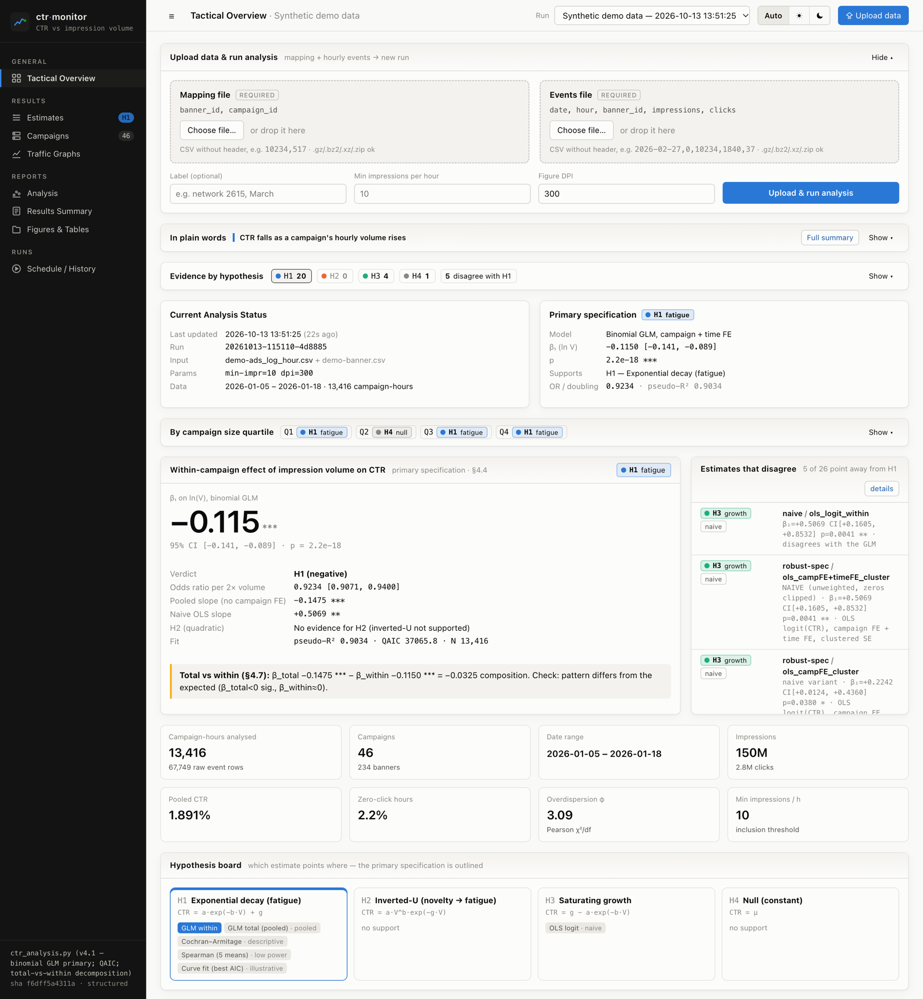
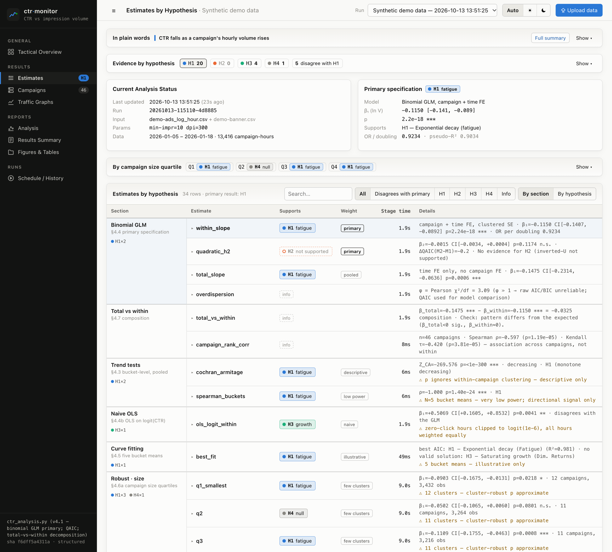
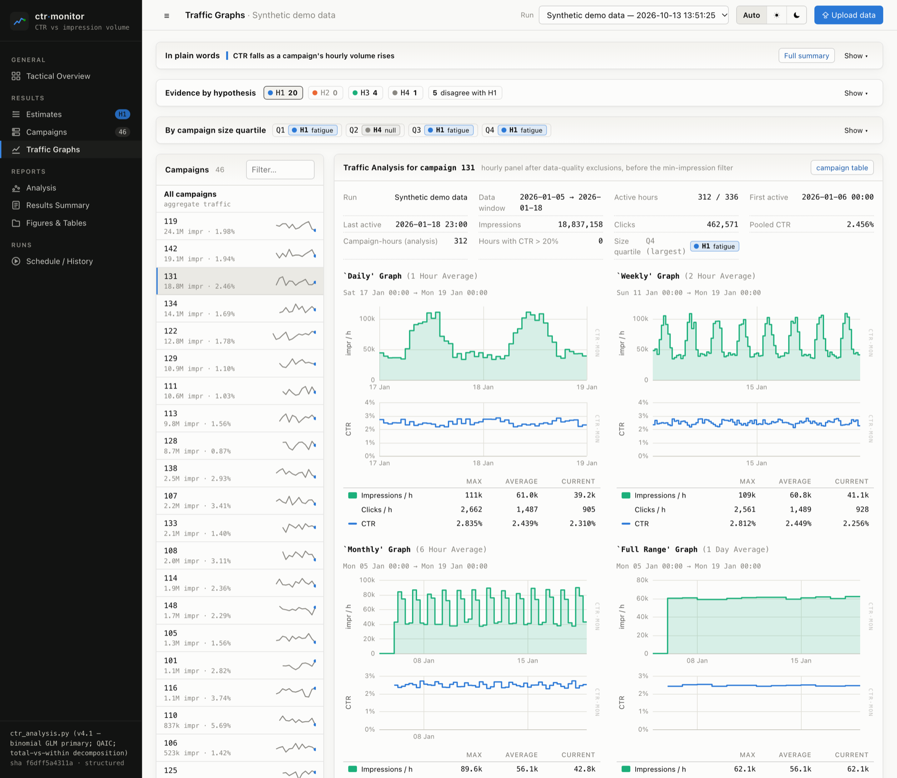
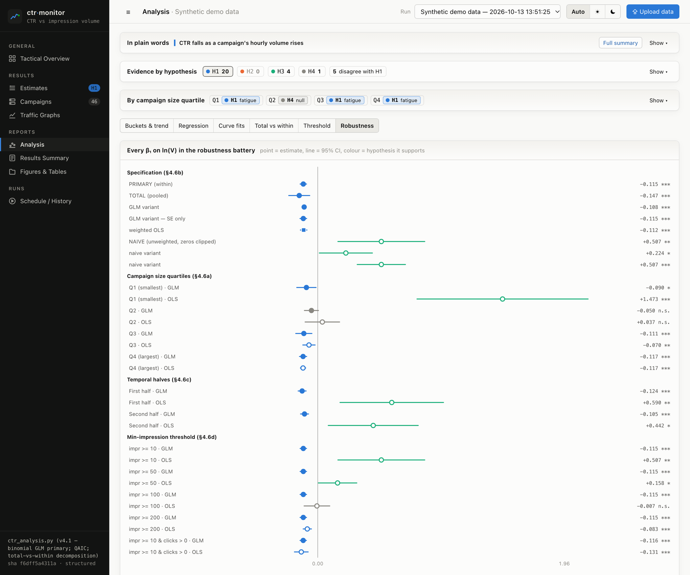
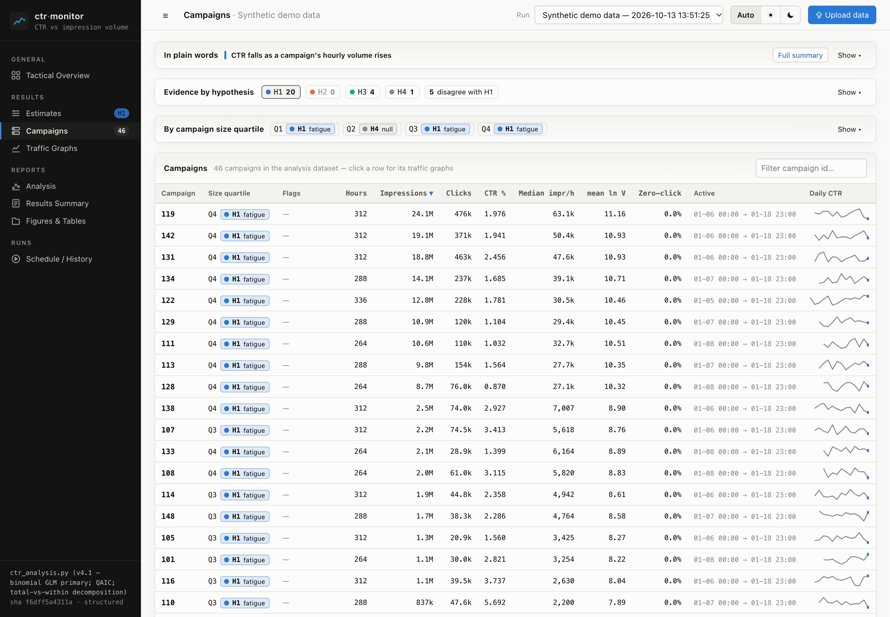
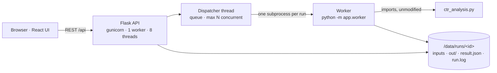

<div align="center">

# ctr·monitor

**Does click-through rate fall as a campaign serves more impressions?**<br>
A Dockerized web console for the study of CTR versus impression volume.
Upload two CSVs and every estimate comes back labelled by the hypothesis it supports, alongside
traffic graphs, interactive versions of the paper's figures and a plain-language summary.


<picture>
  <source media="(prefers-color-scheme: dark)" srcset="docs/screenshots/overview-dark.png">
  
</picture>

<sub>All screenshots use the synthetic demo dataset from <code>tools/make_demo_data.py</code>. No real campaign data.</sub>

</div>

---

## Contents

- [What it answers](#what-it-answers)
- [Features](#features)
- [Screenshots](#screenshots)
- [Quick start](#quick-start)
- [Input data](#input-data)
- [How it works](#how-it-works)
- [Configuration](#configuration)
- [Operations](#operations)
- [HTTP API](#http-api)
- [Development](#development)
- [Project structure](#project-structure)
- [Troubleshooting](#troubleshooting)

## What it answers

The analysis models hourly CTR per campaign as a function of hourly impression volume *V*. The primary
specification is a binomial GLM (logit link) with campaign and hour/day fixed effects and standard errors
clustered by campaign. Every estimate the script produces supports one of four hypotheses:

| | Hypothesis | Shape | Decision rule (the script's `conclusion()`) |
|---|---|---|---|
| **H1** | Fatigue | `CTR = a·exp(−b·V) + g` | slope β < 0, p < .05 |
| **H2** | Novelty → fatigue (inverted U) | `CTR = a·V^b·exp(−g·V)` | quadratic β₂ < 0 with β₁ > 0, p < .05 |
| **H3** | Saturating growth | `CTR = g − a·exp(−b·V)` | slope β > 0, p < .05 |
| **H4** | Null | `CTR = μ` | p ≥ .05 |

On top of that, the analysis splits the **total** (pooled) association into its **within-campaign** part and a
**composition** part, and re-estimates everything across a robustness battery: campaign-size quartiles, time
halves, minimum-impression thresholds and specification variants.

## Features

- **Upload and run.** Drag in a banner→campaign mapping and an hourly event log. Before uploading, the form
  checks column counts, spots swapped files and warns about header rows. Runs are queued, can be cancelled,
  and can be re-run with a different `--min-impr` / `--dpi` without uploading again.
- **Hypothesis-first results.** Every estimate (26 for the v4.1 script, plus 8 informational rows) is labelled
  H1–H4, with a weight tag: *primary*,
  *pooled*, *naive*, *descriptive*, *low power*, *few clusters*, *SE only* or *illustrative*. Every page
  shows an evidence tally and a list of the estimates that disagree with the primary result.
- **Plain-language summary.** 3–5 sentences generated by fixed rules from each run's numbers, with no
  language model involved. It's also exported as `plain_summary.txt`.
- **Traffic graphs.** MRTG-style views per campaign or for all campaigns: impressions/h and CTR over 48 h,
  8 days, 35 days and the full range, each with *Max / Average / Current* rows.
- **Interactive figures.** Figures 1–7 of the paper, redrawn: bucket distributions, marginal effect
  (GLM vs naive OLS), curve fits, total vs within, threshold sensitivity and a forest plot of every
  robustness β. Each has a table view.
- **Campaign size quartiles.** Q1–Q4 cards showing the hypothesis each quartile's GLM slope supports. On the
  Campaigns page they also filter the table.
- **Originals preserved.** The script's own PDFs, every CSV table and `results_summary.txt`, plus a zip of
  the whole run.
- **Faithful to the script.** `ctr_analysis.py` runs unmodified. On a reference dataset the outputs matched a
  direct CLI run byte for byte. Inside the container the only differences are floating-point noise from
  OpenBLAS (≤ 1e-8 relative).
- **Operational.** Live event log, per-stage timings and peak memory. Out-of-memory kills are reported as
  such. Light and dark themes, usable at phone width.

## Screenshots

<table>
  <tr>
    <td width="50%"><br><sub><b>Estimates.</b> Every estimate grouped by section, with the hypothesis it supports, a weight tag and full numbers.</sub></td>
    <td width="50%"><br><sub><b>Traffic graphs.</b> MRTG-style impressions/h and CTR per campaign, with Max/Average/Current.</sub></td>
  </tr>
  <tr>
    <td width="50%"><br><sub><b>Robustness.</b> Every β on ln(V), coloured by the hypothesis it supports; marker shape shows the model.</sub></td>
    <td width="50%"><br><sub><b>Campaigns.</b> Size quartile and its hypothesis, volume, CTR, flags and a daily-CTR sparkline.</sub></td>
  </tr>
</table>

## Quick start

**Requirements:** Docker with Compose v2. For large datasets see [Operations → Memory](#memory-and-large-datasets).

```bash
cd ctr-monitor
docker compose up --build -d              # → http://localhost:8080
```

**Try it without real data:**

```bash
python3 tools/make_demo_data.py          # writes demo-data/demo-banner.csv + demo-ads_log_hour.csv
```

Upload the two files on the start page. The demo run takes a few seconds and plants a mild fatigue effect
that the primary GLM recovers (H1).

**Single-file install** on another machine:

```bash
bash bootstrap.sh                        # writes ./ctr-monitor (uses ./ctr_analysis.py if present)
cd ctr-monitor && docker compose up --build -d
```

## Input data

Two CSV files without header rows, the same inputs as `ctr_analysis.py --mapping … --events …`.
Compressed files (`.gz`, `.bz2`, `.xz`, `.zip`) are accepted.

| File | Columns | Example row |
|---|---|---|
| Mapping | `banner_id, campaign_id` | `10234,517` |
| Events  | `date (YYYY-MM-DD), hour (0–23), banner_id, impressions, clicks` | `2026-02-27,0,10234,1840,37` |

The script aggregates banners to campaign-hours. It drops rows with zero impressions or impossible clicks,
excludes campaigns with no clicks over the whole period (treated as a tracking failure), applies the
minimum-impressions filter and flags hours with CTR > 20 % without removing them. The Dataset section of
each run lists every exclusion.

## How it works



- **The script stays the source of truth.** The worker calls the script's functions in the same order as its
  `main()` and writes the same files. It also keeps the in-memory results so the UI can render them. The
  script's `save()` and `_caption()` hooks are wrapped to add PNG previews and collect figure captions.
- **One process per run.** Each run imports the script fresh, so a new `ctr_analysis.py` takes effect on the
  next run without a restart. Memory is returned to the OS afterwards, and a run can be cancelled by killing
  its process group.
- **Legacy mode.** If a future script version renames the functions the wrapper relies on (listed in
  `backend/app/script_info.py`), the app falls back to the script's own `main()`. You still get the summary,
  files and log.
- **Labels are computed from stored numbers.** Hypothesis labels, the tally, the quartile mapping and the
  plain-language summary are rebuilt from `result.json` on every request. Changing those rules updates older
  runs without re-running them.

## Configuration

Environment variables (set in `ctr-monitor/docker-compose.yml`):

| Variable | Default | Purpose |
|---|---|---|
| `CTR_MAX_CONCURRENT_RUNS` | `1` | Runs executed in parallel. Each is CPU- and memory-heavy. |
| `CTR_MAX_UPLOAD_MB` | `2048` | Request size limit for uploads. |
| `CTR_WEB_DPI` | `110` | DPI of the PNG previews. PDFs use the run's `--dpi`. |
| `CTR_SCATTER_SAMPLE` | `4000` | Raw points sent to the browser for the marginal-effect scatter. |
| `CTR_DATA_DIR` | `/data` | Run storage (a named Docker volume). |
| `CTR_SCRIPT` | `/app/ctr_analysis.py` | The analysis script. Compose bind-mounts `./ctr_analysis.py` here. |

## Operations

### Memory and large datasets

The primary GLM includes one dummy column per campaign, so its design matrix needs about
*rows × (campaigns + 30) × 8 bytes*. The app also runs a garbage collection once per IRLS iteration
(`backend/app/memfix.py`), because statsmodels otherwise keeps every iteration's copy of that matrix alive.
This only changes memory use; the estimates are identical.

As a guide: about 50 campaigns and 15k campaign-hours run in seconds. A dataset with about 800 campaigns and
216k campaign-hours peaked at **17 GB** and took **about 27 minutes** in Docker. Give Docker Desktop enough
memory under *Settings → Resources*. The run page shows each stage's peak memory, and a run killed for lack
of memory is reported as *"Out of memory … during &lt;stage&gt;"*.

### Updating the analysis script

Replace `ctr-monitor/ctr_analysis.py`. Compose bind-mounts it read-only, and the next run uses it with no
rebuild or restart needed. The sidebar shows the version line and SHA of the script in use, and each run
records the version it ran with.

### Data and privacy

Uploads and results live in the `ctr-data` Docker volume, under `/data/runs/<id>/`. The app has **no
authentication**, so Compose publishes it on `127.0.0.1` only. Put it behind an authenticating reverse proxy
before exposing it to a network. Run `docker compose down -v` to remove the container *and* all stored runs.

## HTTP API

All endpoints are under `/api` and return JSON unless noted.

| Method | Path | Description |
|---|---|---|
| `GET` | `/health` | Liveness check |
| `GET` | `/info` | Script version, SHA and structured/legacy mode; server limits |
| `GET` | `/runs` | All runs with status, hypothesis tally and primary result |
| `POST` | `/runs` | Create a run. Multipart `mapping`, `events`, optional `label`, `min_impr`, `dpi`, or `from_run=<id>` to reuse inputs. |
| `GET` | `/runs/<id>` | Run metadata, live progress (stage, timings, peak memory), error and traceback |
| `POST` | `/runs/<id>/cancel` | Cancel a queued or running run |
| `DELETE` | `/runs/<id>` | Delete a run and its files |
| `GET` | `/runs/<id>/result` | Structured results: dataset, regression, curves, robustness, checks, chart data |
| `GET` | `/runs/<id>/narrative` | Plain-language summary (headline, sentences, hypothesis) |
| `GET` | `/runs/<id>/log?offset=n` | Worker output, incremental from byte offset `n` |
| `GET` | `/runs/<id>/mrtg?campaign=<id>` | Traffic windows for one campaign, or all campaigns |
| `GET` | `/runs/<id>/tables/<name>.csv` | One output table as JSON |
| `GET` | `/runs/<id>/files/<name>` | Raw output file. Add `?download=1` to download it. |
| `GET` | `/runs/<id>/bundle.zip` | All outputs plus log and plain summary (zip) |

## Development

```bash
# backend: needs the packages in ctr-monitor/backend/requirements.txt
cd ctr-monitor/backend && python wsgi.py          # http://127.0.0.1:5000 (no reloader)

# frontend
cd ctr-monitor/frontend && npm install && npm run dev   # http://localhost:5173, proxies /api → :5000
```

After changing anything under `ctr-monitor/`, regenerate the single-file installer:

```bash
python3 tools/make_bootstrap.py
```

Python dependencies are pinned to the versions that produced the reference results (numpy 2.3.2,
pandas 3.0.1, scipy 1.16.1, statsmodels 0.14.6, matplotlib 3.10.5). Frontend dependencies are pinned in
`package-lock.json`.

## Project structure

```
.
├── ctr-monitor/
│   ├── ctr_analysis.py          # the analysis script (unmodified, drop-in replaceable)
│   ├── docker-compose.yml       # one service on 127.0.0.1:8080, named volume ctr-data
│   ├── Dockerfile               # multi-stage: Node builds the UI, Python serves API + UI
│   ├── backend/
│   │   ├── wsgi.py
│   │   └── app/
│   │       ├── api.py           # REST endpoints
│   │       ├── jobs.py          # run queue / dispatcher, failure reporting
│   │       ├── worker.py        # one run per subprocess
│   │       ├── pipeline.py      # mirrors the script's main(), builds result.json
│   │       ├── checks.py        # H1–H4 labels, weights, tally, size quartiles
│   │       ├── narrative.py     # rule-based plain-language summary
│   │       ├── series.py        # MRTG traffic windows
│   │       └── memfix.py        # frees statsmodels' per-iteration IRLS copies
│   └── frontend/src/
│       ├── pages/               # Overview, Estimates, Campaigns, Graphs, Analysis, Summary, Files, Runs
│       ├── charts/              # hand-rolled SVG charts (MRTG, forest, curves, …)
│       └── components/          # upload form, tally, summary, quartile cards, UI kit
├── tools/
│   ├── make_bootstrap.py        # regenerates bootstrap.sh
│   └── make_demo_data.py        # synthetic demo dataset
├── bootstrap.sh                 # generated single-file installer
└── docs/screenshots/
```

Deeper technical notes are in [`ctr-monitor/README.md`](ctr-monitor/README.md).

## Troubleshooting

| Symptom | Cause and fix |
|---|---|
| Run fails with *"Out of memory … during Regression"* | The Docker VM ran out of memory. Raise it under Docker Desktop → *Settings → Resources* and use **Re-run** to repeat with the same inputs. |
| *"This script lacks … runs use its own main()"* | The script in use doesn't expose the functions the wrapper needs. Runs still work in legacy mode (summary, files, log). |
| Upload form warns *"expected 5 columns, found 2"* | The two files are swapped. Use **Swap them** in the form. |
| Page shows *Backend unreachable* | Check `docker compose ps` and `docker compose logs ctr-monitor`. |
| Port 8080 already in use | Change the host port in `docker-compose.yml`, e.g. `"127.0.0.1:8090:8080"`. |
